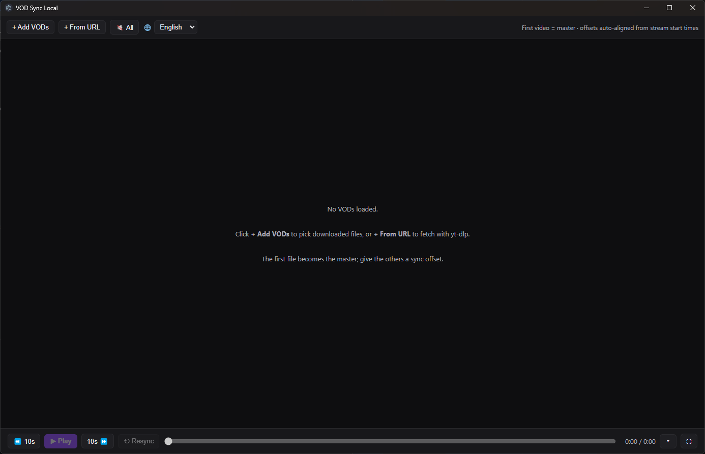

# MultiTwitchVODWatcher

Watch **multiple Twitch VODs at once, perfectly in sync** — locally on your desktop.
Download the VODs with [yt-dlp](https://github.com/yt-dlp/yt-dlp), load them side by side, and one play/pause/seek drives them all. VODs are auto-aligned by each stream's start time, with manual nudges for per-stream delays. Handy for multi-POV events, races, and co-streams.



## Features

- **1–8+ videos at once**, laid out to fill the window (no scrolling).
- **Automatic alignment** from the stream start time (read from yt-dlp metadata); manual `±` offset nudges for ingest delays.
- **One transport** for everything: Play/Pause, `±10s` skip, and a shared timeline you can scrub. Works with `Space`, `←`/`→`, and your **media keys**.
- **Per-VOD controls** on hover: volume, mute, sync offset, resync.
- **Timeline ruler** (`▾`) showing each VOD's span plus its real start time and offset vs. the master.
- **Drag to reorder** tiles — drop one at the front to make it the master.
- **Built-in downloads** via yt-dlp: paste URLs and go. It fetches the streamer name, **skips URLs you already downloaded**, and can **update yt-dlp** itself. Non-master VODs start muted.
- **Library** (`Library` button): browse and manage downloaded VODs with thumbnails — add them to the player or delete them from disk.
- **Remembers everything**: VOD list, offsets, resume position, download folder, language. **Export/import** a session as a JSON file to share a setup.
- **Localizable**: add a language by dropping a JSON file into `locales/`.
- **Fullscreen "cinema" mode**, desktop notifications for finished downloads, and **auto-update** for installed builds (Windows/Linux).
- **Portable** build: keeps `session.json` and downloads next to the executable.

## Download

Get the latest build from the **[Releases page](https://github.com/CodeTappert/MultiTwitchVODWatcher/releases)**.

- **Windows**: `Twitch VOD Sync Setup <version>.exe` (installer — **auto-updates**) or `Twitch VOD Sync <version>.exe` (portable, no install).
- **Linux**: `…AppImage` (**auto-updates**) or the `.deb`.
- **macOS**: `.dmg` / `-mac.zip` for both **Apple Silicon (arm64)** and **Intel (x64)**.

The builds bundle **yt-dlp**; grab **ffmpeg** too if you download high-quality streams (see below).

## Requirements

The released builds **bundle yt-dlp**, so for downloading you additionally need **ffmpeg** (yt-dlp merges video + audio with it) — install it, or drop `ffmpeg`(`.exe`) into the app's `bin/` folder (or wherever is on your `PATH`). The app shows a hint with a download link when ffmpeg is missing.

To **build** from source:

- [Node.js](https://nodejs.org) 18+ (tested on 22) and npm
- [yt-dlp](https://github.com/yt-dlp/yt-dlp) — only for local dev (the packaged app ships its own)
- [ffmpeg](https://ffmpeg.org) on your `PATH`

## Build & run from source

```bash
npm install
npm start
```

Package for distribution (output in `dist/`):

```bash
npm run dist         # current OS
npm run dist:win     # Windows: NSIS installer + portable exe
npm run dist:linux   # Linux: AppImage + .deb
npm run dist:mac     # macOS: dmg + zip
```

There's also a `Makefile` (`make win` / `make linux` / `make mac` / `make start`) and, on Windows, `build.bat [win|linux|mac]`.

Tests:

```bash
npm test      # unit tests (Node's built-in runner)
npm run e2e   # end-to-end (Playwright + Electron)
```

> **Windows build note:** if the build fails with a `winCodeSign` symlink error, set `CSC_IDENTITY_AUTO_DISCOVERY=false` before building (or enable Windows Developer Mode). Builds are unsigned by default.

## Usage

See the **[Usage guide](docs/USAGE.md)**.

Quick start:

1. **Add videos**: `+ Add VODs` for files you already have, `+ From URL` to download from Twitch, or open **Library** to reuse something you downloaded before.
2. The **first** video is the **master**; the others are **auto-aligned** using their stream start times. Drag a tile to reorder — drop one at the front to make it the master.
3. If a stream still looks off, open a tile's **hover controls** and nudge its **Sync** offset (`±0.1` / `±1`).
4. Hit **Play** — every video plays together. Scrub the timeline, use `←`/`→`, or your media keys. **Export/Import** shares a setup as a JSON file.

## Localization

The UI is translated via JSON files in [`locales/`](locales). To add a language:

1. Copy `locales/en-GB.json` to `locales/<code>.json` (e.g. `fr-FR.json`).
2. Set `meta.code` and `meta.name` (the language's own name), and translate the values.
3. Reload — it appears in the language picker. PRs welcome!

## Contributing

Contributions of all kinds are welcome — bug reports, feature ideas, code, and translations.

- **Issues**: open an [issue](https://github.com/CodeTappert/MultiTwitchVODWatcher/issues) for bugs or ideas. Screenshots and logs make it much easier to help.
- **Pull requests**: please target the **`develop`** branch (not `main` — that's the release branch).
- **Setup**: `npm install`, then `npm start`. There's no build step — it's plain JS/HTML/CSS.
- **Tests**: `npm test` (unit) and `npm run e2e` (Playwright/Electron) — make sure both are green. CI runs them on every PR.
- **Translations**: see [Localization](#localization) — just add a `locales/<code>.json`.
- **Not sure?** Open a draft PR or an issue and ask — happy to help.

There are no strict style rules; matching the surrounding code is enough.

## License

MIT — see [LICENSE](LICENSE).

## AI usage

This project was written with the help of AI coding assistants. All changes are reviewed and tested by the maintainer.

